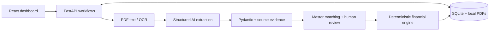

# Zamp PS-1 · AI Invoice Processing

A local or protected-demo invoice-processing application built with React, FastAPI and
SQLite. PDF invoices become evidence-backed drafts matched to existing vendor and
purchase-order data. Human confirmation precedes deterministic financial checks
and any approved allocation. The application does **not** initiate payments.

## Problem and approach

Accounts payable must prevent duplicate invoices and spending beyond received
quantities or authorized PO balances. Invoice layouts vary, so AI helps extract
unstructured information. Financial authorization must remain reproducible: the
backend applies explicit rules instead of accepting an AI approval recommendation.

## Deploy a protected demo on Render

Use a single **Docker Web Service** with [render.yaml](render.yaml), or select this
repository in Render's **New → Web Service** and choose the Docker runtime. React
is built inside the multi-stage image; FastAPI serves it and the APIs on
`0.0.0.0:$PORT`. Tesseract and English data are included. Do not set a custom start
command: the entrypoint validates access credentials, initializes only a new DB,
and starts one backend worker.

1. Merge the deployment PR, then connect GitHub in Render and select this repo's
   `main` branch, repository root, and `Dockerfile`. Alternatively create a Blueprint
   from `render.yaml`. The provided blueprint selects the Free plan.
2. In the service's **Environment** settings, set the following before deploying:

   | Variable | Value |
   | --- | --- |
   | `ZAMP_DEMO_USERNAME` | Your chosen demo login (no colon) |
   | `ZAMP_DEMO_PASSWORD` | A unique random secret, at least 24 characters |
   | `ZAMP_REQUIRE_DEMO_AUTH` | `1` (required by the container entrypoint) |
   | `GEMINI_API_KEY` | Your own Gemini key; server runtime only |
   | `GEMINI_MODEL` | `gemini-3.1-flash-lite` |
   | `ZAMP_DB_PATH` | `/data/zamp.sqlite3` |
   | `ZAMP_DOCUMENT_DIR` | `/data/documents` |

   Render supplies `PORT`; do not hardcode it. Never use `VITE_*` variables for
   secrets or put credentials in Git, build arguments, URLs or screenshots. Generate
   the demo password in a password manager. Without a Gemini key, manual review is
   supported; leave the key unset rather than inventing a successful AI result.
3. **Storage choice:** Render Free's filesystem is temporary. Records and PDFs can
   disappear on restart, redeploy or instance replacement; Free services can also
   sleep and cold-start. A fresh filesystem will receive fresh synthetic master
   data. For retention, select a paid instance and attach a persistent disk mounted
   at **`/data`** *before* the first useful upload. The Free blueprint deliberately
   has no disk. Do not run multiple replicas/workers against this SQLite workflow.
   Both storage paths are configurable; for a disk keep both beneath its mount.
   The root bootstrap gives UID 10001 access to `/data`, then the server runs without
   root privileges. Custom mount roots need equivalent writable permissions.
4. Set **Health Check Path** to `/health` (already in the blueprint), then deploy.
   Render displays the HTTPS `https://<service-name>.onrender.com` URL at the top of
   the service dashboard after provisioning. Open that URL and enter the demo login
   in the browser's authentication prompt. Use HTTPS exclusively; Basic authentication
   is encrypted in transit by Render's TLS, not by the authentication scheme itself.
5. Test the actual hosted URL: unauthenticated `/` and `/api/master-data` must return
   401, `/health` must return only `{"status":"ok"}`, and login must load the React
   dashboard and protected APIs. Run the synthetic [A/B/C demo](docs/demo-walkthrough.md)
   on a fresh state. With a paid disk, restart the service and verify the same runs,
   PDFs and remaining balance persist. **A local Docker pass is not a verified Render
   deployment; the hosted URL still needs these checks.**

The container seeds vendor, PO and receipts only after exclusively creating a
previously nonexistent SQLite file. It never resets or reseeds an existing file,
including an empty or damaged one. Back up before maintenance; investigate failed
initialization rather than deleting a valuable DB. The runtime schema initialization
uses the existing code; no new migration framework is introduced. Back up SQLite and
uploaded PDFs together while the service is stopped. Adding a disk does not migrate
data from an earlier ephemeral instance.

All UI/assets, API aliases, legacy routes, PDF downloads and API documentation are
protected. Only the minimal `/health` endpoint is public. Mutating browser requests
from another origin are rejected; authenticated responses disable browser caching.
This is a shared demo login, without roles, individual reviewer identity, rate
limiting or an application logout. Use a unique long random secret, share narrowly,
and close private browser sessions after use. Rotate it in Render and redeploy to
revoke old credentials. Do not use this gate as production financial access control.

Local Docker verification (Docker Desktop also works on Windows):

```powershell
docker build -t zamp-render .
# Set the two demo credentials securely in this shell first; pass names, not values.
docker volume create zamp-demo-data
docker run --rm --name zamp-demo -p 8000:8000 --mount source=zamp-demo-data,target=/data -e ZAMP_DEMO_USERNAME -e ZAMP_DEMO_PASSWORD -e GEMINI_API_KEY -e GEMINI_MODEL zamp-render
```

Open `http://127.0.0.1:8000` for local testing only. The existing
[Windows non-Docker setup](docs/windows.md) still works with authentication disabled
when both demo credential variables are unset. Setting both enables the same gate
locally. Do not export a requirement flag without configuring valid credentials.

## Key capabilities

- Drag-and-drop PDF intake, SHA-256 upload deduplication and persisted stage status.
- Native PyMuPDF extraction and per-page English Tesseract OCR fallback.
- Gemini/OpenAI structured extraction, Pydantic validation and source citations.
- Exact master-data matching, PO suggestions and unresolved-field review.
- Business duplicates, partial invoicing, cumulative amounts, quantities, receipts
  and an explicitly authorized conditional 2% amount-tolerance policy.
- Human confirmation, Approved/Review/Rejected decisions, atomic allocations,
  safe retries, dashboard, history, evidence and audit views.
- Credential-free **Manual review** using real PDF text and financial checks;
  it does not generate AI fields or citations.

The owner reports successful Windows/React scenarios using **`gemini-3.1-flash-lite`**:
a $400 approval, business-duplicate rejection and $700 over-budget rejection.
These are manually observed local results, not CI results. Current automated
verification is recorded separately in [validation](docs/validation.md). No live
Gemini call was made in Codex during this submission pass.

## Technology and architecture

| Layer | Implementation |
| --- | --- |
| Frontend | React, TypeScript, Vite, Tailwind CSS; real `/api` HTTP requests |
| Backend | Python 3.12, FastAPI, Pydantic; standard-library SQLite access |
| Documents | PyMuPDF, Pillow, pytesseract + separately installed Tesseract 5/English |
| Providers | Backend-only Gemini `generateContent` and OpenAI chat/completions adapters |
| Persistence | SQLite plus local content-addressed PDF storage |
| Tests | pytest, Vitest/Testing Library, Playwright/Chromium |



The UI polls recorded stages. AI cannot allocate money: after review, the engine
checks current balances and commits the financial run/allocation atomically. See
[architecture](docs/architecture.md) for the sequence and transaction boundaries,
and [business rules](docs/business-rules.md) for the exact policy.

## Installation and startup

Use **Python 3.12**, **Node.js 24**, Git and Tesseract 5 with English data. Python
and frontend dependencies are pinned in `requirements-lock.txt` and
`frontend/package-lock.json`.

The [Windows PowerShell setup](docs/windows.md) is the evaluator quickstart: clone,
virtual environment, OCR, secure key entry, fresh database, frontend build and startup.
`.env.example` documents variables; the application does **not** load `.env` files
automatically. Keys belong only in the backend environment, never `VITE_*` variables.

Linux equivalent, from the repository root after installing English Tesseract:

```sh
python3.12 -m venv .venv
.venv/bin/python -m pip install -r requirements-lock.txt
npm --prefix frontend ci
npm --prefix frontend run build
export ZAMP_DB_PATH=data/submission-demo.sqlite3
export ZAMP_DOCUMENT_DIR=data/submission-documents
export GEMINI_MODEL=gemini-3.1-flash-lite
# Supply GEMINI_API_KEY through your secure backend environment when using Gemini.
# Seed only a fresh demo path:
.venv/bin/python -c "import os; from scripts.seed import seed; seed(os.environ['ZAMP_DB_PATH'])"
.venv/bin/python -m uvicorn app.main:app --host 127.0.0.1 --port 8000
```

Open `http://127.0.0.1:8000` in your browser. Build before starting FastAPI; it mounts
`frontend/dist` only when that directory exists at startup. `/docs` exposes the API
schema and `/health` checks database access. Use **one Uvicorn worker** and keep this
local prototype on loopback; configure the demo gate before exposing it publicly.

For Vite development, keep FastAPI running and execute `npm --prefix frontend run dev`
in a second terminal. Vite proxies `/api` to port 8000; optional `ZAMP_API_TARGET`
changes that target. The built app needs no separate Vite server.

### Configuration and seeding

| Variable | Purpose |
| --- | --- |
| `ZAMP_DB_PATH` | Database; default `data/zamp.sqlite3` |
| `ZAMP_DOCUMENT_DIR` | PDF directory; defaults beside the selected database |
| `TESSERACT_CMD` | Optional full executable path; otherwise PATH discovery |
| `GEMINI_API_KEY` / `GEMINI_MODEL` | Backend Gemini credential and model selection |
| `OPENAI_API_KEY` / `OPENAI_MODEL` | Optional OpenAI alternative; model fallback `gpt-4.1-mini` |

Explicitly select **`GEMINI_MODEL=gemini-3.1-flash-lite`** for the owner-verified demo.
The unchanged application's fallback, used only if unset, is `gemini-3.5-flash-lite`.
Access, quota and model availability are account-specific. No automatic provider/
model fallback or retries of paid calls are performed.

`seed(path)` creates DEMO-VENDOR, DEMO-PO ($1,000, 10 chairs at $100) and a receipt
for 10 chairs. It inserts **no invoices**. `python -m scripts.seed` specifically
targets `data/demo.sqlite3`, ignoring `ZAMP_DB_PATH`; use the explicit command above
for another path. Seeding is not a reset: existing allocations remain.

## Reproducible demo

Follow [the ordered A/B/C walkthrough](docs/demo-walkthrough.md) on one fresh seeded
database. It covers React actions, expected evidence, evaluator checkpoints and state.

| Fixture | Business identity | Role |
| --- | --- | --- |
| `fixtures/native_invoice.pdf` | SYN-001, 4 chairs, $400 | Approval; leaves $600 |
| `fixtures/duplicate_invoice_variant.pdf` | Same SYN-001/vendor, different bytes | Business duplicate; balance stays $600 |
| `fixtures/over_budget_invoice.pdf` | Unique SYN-002, 7 chairs, $700 | Amount, quantity and receipt violations; balance stays $600 |
| `fixtures/scanned_invoice.pdf` | Image-only SYN-001 | Optional separate OCR check |

All are synthetic and not payable. The generator recreates only native/scanned
fixtures; do not regenerate PDFs mid-demo because byte identities can change.

## Automated tests

```sh
.venv/bin/python -m pytest -q
.venv/bin/python -m scripts.smoke
npm --prefix frontend test
npm --prefix frontend run build
cd frontend
npx playwright install chromium
npm run test:e2e
```

On Windows use `.\.venv\Scripts\python.exe`; complete PowerShell commands are in
[Windows setup](docs/windows.md). Provider contract tests use explicit HTTP mocks.
Optional live tests need credentials **and** `ZAMP_RUN_LIVE_AI=1`. Separately,
`python -m scripts.check_gemini` makes one live synthetic request and reports safe
validation flags without invoice contents. Manual-mode browser tests do not test
live AI. See [results and evidence provenance](docs/validation.md).

## Known limitations and future improvements

Single-host prototype: optional shared demo authentication, but no user roles,
tamper-evident audit, encrypted
storage, distributed queue, migration system or payment execution. Reviewer identity
is self-reported. Money uses two decimal places, one PO/currency per invoice and
whole units; credit notes and fractional units are unsupported. Confirmed invoices
are immutable; there is no correction/release workflow. Source evidence establishes
textual grounding, not authenticity or complete business-semantic correctness.

Future work includes authenticated roles, audited corrections/reversals, migrations,
isolated document workers, production backup/monitoring and broader invoice/currency
coverage. These are proposals, not implemented features. Real data requires suitable
access control and retention policies before use.

## Documentation

- [Windows setup](docs/windows.md) · [Demo walkthrough](docs/demo-walkthrough.md)
- [Architecture](docs/architecture.md) · [Financial rules](docs/business-rules.md)
- [Validation](docs/validation.md) · [Submission audit](docs/submission-audit.md)
- [Render packaging verification](docs/render-validation.md)
- [API/workflow reference](docs/phase4.md) · [Gemini troubleshooting](docs/gemini-integration.md)
- [Synthetic browser screenshot](docs/screenshots/dashboard.png): automated local
  browser activity, not the owner's live Gemini session.
