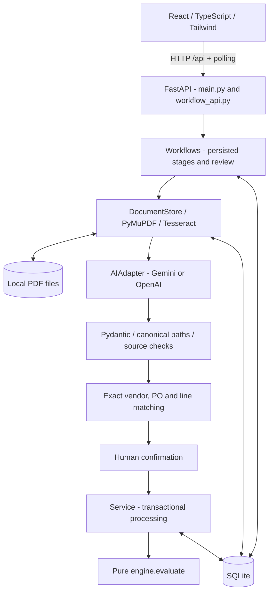

# Architecture

Zamp PS-1 separates unstructured-document extraction from financial authorization.
AI handles layout variation and proposes nullable facts with source citations.
Pydantic and source checks reject unsupported outputs; a human resolves uncertainty.
The deterministic engine alone decides whether an allocation is allowed.

## Components



| Module | Responsibility |
| --- | --- |
| `app/main.py` | Factory, original master/invoice/document endpoints, optional built-UI mount |
| `app/workflow_api.py` | `/api` workflow/history/dashboard/configuration/master-data/receipt routes |
| `app/workflows.py` | Stage transitions, exact matching, review, restart recovery, history |
| `app/documents.py` | Bounded PDF text/OCR, hashes, document/extraction records |
| `app/extraction.py` | Provider contracts, strict response validation and safe errors |
| `app/schemas.py` | Canonical input validation and cent conversion |
| `app/service.py` | Master data, receipts, immutable invoices, financial transactions |
| `app/engine.py` | Pure deterministic evaluation of transaction-consistent facts |
| `frontend/src/` | Dashboard, upload, timeline, evidence, review, decisions, audit, receipts |

Vite proxies `/api` during development. FastAPI serves `frontend/dist` when present
at startup. Hash navigation supports detail-page reloads. The browser never gets
provider keys or computes approval. Polling shows stored states, not timed fake progress.

## Invoice-processing sequence

```mermaid
sequenceDiagram
    actor User
    participant UI as React
    participant API as FastAPI
    participant W as Workflow background task
    participant AI as Provider
    participant S as Financial service
    participant DB as SQLite / files
    User->>UI: Upload PDF and select provider/manual mode
    UI->>API: POST /api/workflows + idempotency key
    API->>DB: Persist bytes, unique digest/key and queued run
    API-->>UI: 202 canonical workflow
    API->>W: Schedule execution
    W->>DB: Claim run; record each stage
    W->>W: Native text / per-page OCR if sparse
    alt AI selected
        W->>AI: Numbered extracted text pages
        AI-->>W: Structured response
        W->>W: Pydantic and source-evidence checks
    else Manual review
        W->>DB: AI stage explicitly skipped
    end
    W->>W: Match existing master data
    W->>DB: Review state, draft and evidence
    UI->>API: Poll recorded state
    User->>UI: Check source, mappings, reviewer note and confirmation
    UI->>API: POST /api/workflows/id/review
    API->>DB: Atomic invoice + source/workflow link + confirmation event
    API->>W: Queue financial processing
    W->>S: Process linked invoice with attempt key
    S->>DB: BEGIN IMMEDIATE; read allocations/receipts
    S->>S: Evaluate explicit financial policy
    S->>DB: Commit run and Approved allocation/lines atomically
    S-->>W: Decision and reasons
    W->>DB: Separately persist workflow decision
    UI->>API: Poll decision and audit
    API-->>UI: Recorded results
```

PDF/provider/schema/evidence failures record a failed stage rather than reaching
approval. See [business rules](business-rules.md) for decision reasons and severity.

## Persistence and transaction boundaries

| Data | Tables |
| --- | --- |
| Master | `vendors`, `purchase_orders`, `po_lines`, `receipts` |
| Financial | `invoices`, `processing_runs`, `allocations`, `allocation_lines` |
| Documents | `documents`, `extraction_runs`, `invoice_documents` |
| Workflow | `workflows`, `workflow_keys`, `workflow_events` |

Invoice lines are stored in immutable JSON; PO/allocation lines are relational.
Amounts use integer cents; quantities are integers. Foreign keys protect references.
The low-level invoice API can retain unknown vendor/PO references for an explicit
engine decision; workflow confirmation first requires existing master references.

1. **Upload:** bytes are durable before the workflow transaction. Digest uniqueness
   returns one workflow for identical bytes regardless of upload key. A key cannot
   bind different bytes. Complete files are published by hard link from temporary
   files. Filenames are hashes, not user paths. Filesystem/DB failures may leave
   orphan files; back up the DB and matching document directory together.
2. **Execution:** transactional queued-to-processing compare-and-set permits one
   task to claim a run. Each stage/event update commits before the next stage.
3. **Review:** invoice, source link, workflow invoice link and confirmation event
   share one `BEGIN IMMEDIATE` transaction. `Service.create_invoice(..., db=...)`
   participates in it. Identical repeated confirmation reuses the linked invoice;
   changed confirmed content conflicts instead of being overwritten.
4. **Finance:** `Service.process` locks writes before reading current balances and
   receipts. Run, Approved allocation and allocation lines commit or roll back
   together. Unique invoice/allocation and run-key constraints are final safeguards.
   Review/Rejected results create no allocation.
5. **Final workflow state:** updated separately after finance. A crash after an
   allocation but before this update is safe: processing the linked approved invoice
   replays approval and cannot allocate twice. Same key replays a recorded result;
   a new key may reevaluate an unapproved invoice against current receipt/master data.

Workflow Approved/Rejected retries replay terminal state. Linked financial Review
can rerun after receipts are added. Unconfirmed Review needs the review form.
Confirmed invoice content is immutable; there is no correction/reversal workflow.

## Documents, AI, matching and human control

PDF intake checks MIME/extension, 10 MiB, 20 pages, malformed/encrypted/unreadable
content. Pages with fewer than 30 alphanumeric characters use English OCR at 200 DPI,
with 12 million pixels and 30 seconds per OCR call. Text is capped at 100,000
characters. These bounds are not a complete hostile-file sandbox.

Providers receive extracted text, not PDF binaries. Missing facts stay null. Gemini
request hints omit `maxItems` after the documented Windows investigation; local
Pydantic limits remain 200 lines and 1000 citations. Only a single exact, unambiguous
`invoice.` alias may be normalized to an existing non-null scalar path. The unchanged
source validator checks actual pages, quote presence, numeric/string support and
complete non-null-field coverage. Grounding does not authenticate a document or
guarantee a quotation has the right business meaning.

Matching uses exact vendor references or a unique case-insensitive exact vendor name;
PO/line references must exist. Suggestions never create/select identifiers. Every
workflow draft awaits human confirmation, including exact matches. Reviewer identity
is self-reported. AI cannot allocate funds or bypass current-balance checks.

## Audit, failures and operating limits

Use one Uvicorn process. FastAPI background tasks run after HTTP 202. Startup resumes
queued runs and marks interrupted processing as failed, requiring explicit retry.
This is not a distributed queue with worker leases. Parsing/model calls are blocking
threadpool work; OCR executable selection is scoped under a lock.

Safe categories distinguish request/model access/rate/service/transport/schema/evidence
failures. There are no automatic paid-call retries or model switches. Keys stay in
backend headers to fixed hosts, with TLS/proxy verification. Configuration returns
readiness booleans/model names, not credentials.

Events retain stages, safe causes, decisions and reviewed submissions. This is an
application audit trail, not a signed/tamper-evident ledger. Local PDFs, invoice text
and SQLite data are not encrypted. Authentication/roles, migrations, process isolation,
backups/retention, monitoring and a distributed queue remain production work.
