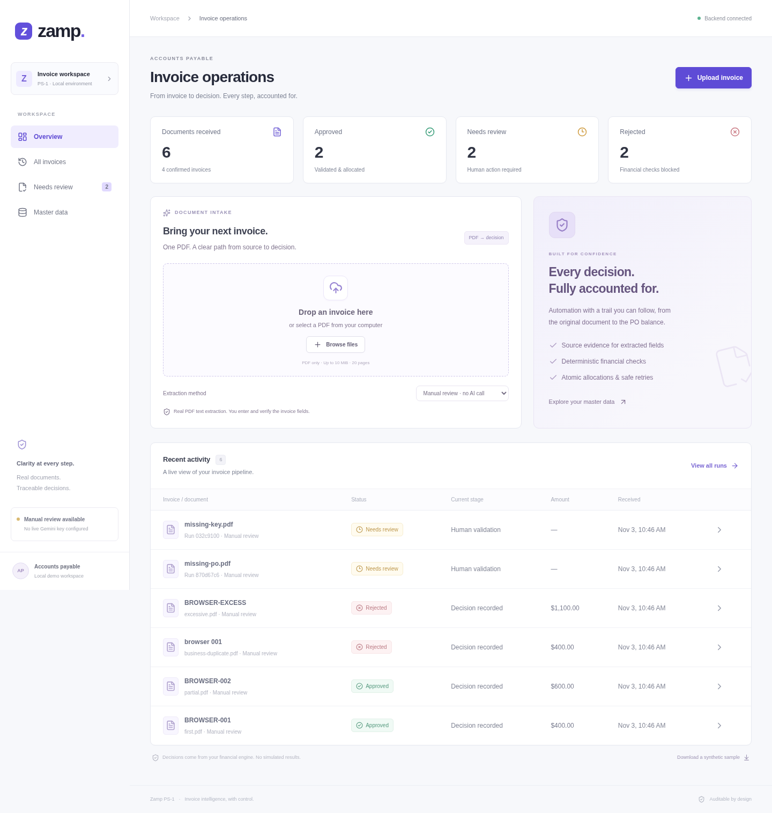
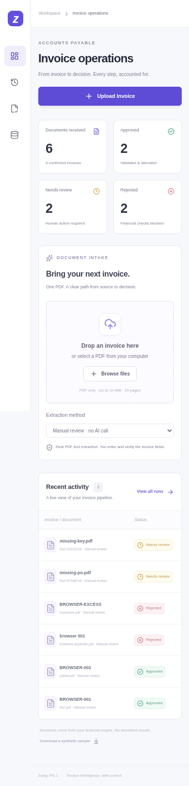

# Five-minute Zamp PS-1 demo

## Start the full app

Use Python 3.12, Node 22.12+ (validated with Node 24), and English Tesseract 5.
From the repository root:

```sh
python -m venv .venv
.venv/bin/python -m pip install -r requirements-lock.txt
.venv/bin/python -m scripts.seed
cd frontend
npm ci
npm run build
cd ..
ZAMP_DB_PATH=data/demo.sqlite3 .venv/bin/python -m uvicorn app.main:app --host 127.0.0.1 --port 8000
```

Open `http://127.0.0.1:8000` in a local browser. Use one Uvicorn worker. There is no
authentication; keep this local demo on loopback. The compiled UI uses same-origin
`/api` requests, with no browser API keys or client-generated decisions. Dev mode:
keep the backend running, then `cd frontend && npm run dev` in a second shell.

`scripts.seed` creates the separate synthetic `data/demo.sqlite3`, not your default
app database. It is idempotent. If that demo database already contains approvals,
its balances remain consumed: use a new explicit database path and seed that path
with `python -c "from scripts.seed import seed; seed('data/another-demo.sqlite3')"`.
Do not delete or reset a database containing work you want to preserve.

## Demo path

1. **Overview (30s):** explain real workflow counts, decisions and recent activity.
   On a new database the dashboard is empty; it does not manufacture history.
2. **Intake (45s):** download the synthetic sample from Overview, or use
   `fixtures/native_invoice.pdf`. Drag it onto the upload zone. Gemini is used only
   when configured; otherwise choose **Manual review · no AI call**. Native PDF/OCR
   stages execute for real. Watch the actual persisted timeline.
3. **Evidence and review (90s):** with Gemini, inspect each source quote and page.
   Without a key, the UI explicitly says no AI evidence was generated. Read the
   Document text tab. For the committed sample enter:

   | Field | Value |
   | --- | --- |
   | Invoice number | SYN-001 |
   | Vendor | Synthetic Office Supply / DEMO-VENDOR |
   | PO | DEMO-PO |
   | Currency | USD |
   | Line | L1, Office chairs, quantity 4, unit price 100.00 |
   | Tax / shipping / discount | Explicitly verify 0.00 each |
   | Invoice total | 400.00 |

   Enter reviewer/name and review note, check confirmation, and choose **Confirm &
   process**. Missing fields and unresolved mappings cannot be silently approved.
4. **Decision (60s):** show the engine result, reasons, invoice value, earlier
   allocation, original PO ceiling, and immutable confirmed fields. This sample
   approves against the seeded receipt and leaves USD 600.00 available.
5. **Audit and retry (45s):** open the audit trail, reload the page, and upload the
   same PDF again. It returns the same workflow and allocation. Master data shows
   the real remaining balance. Explain the Rejected and Review cases exercised by
   the automated browser tests (business duplicates, excessive amounts, missing PO).

The application never initiates a payment. A reviewer may explicitly correct
extracted values before confirmation; that final submission is retained in the audit.
After confirmation the invoice cannot be silently edited. For receipt shortfalls,
record the missing receipt in Master data and select **Rerun checks** on the run.

## Gemini securely

Export **`GEMINI_API_KEY`** only in the backend environment. Optional model selection
is **`GEMINI_MODEL`**, default `gemini-2.5-flash`. Restart the server after configuring
it. The indicator reads a readiness boolean; it does not prove provider authorization.
Do not put a key in a `VITE_*` variable, frontend `.env`, source code, or screenshots.
See `.env.example` and `docs/phase4.md` for network and provider details. `.env` files
are not automatically loaded. Use secure environment settings or a shell prompt
that does not echo the key; never paste it into chat.

No live Gemini or OpenAI key was available during implementation. The manual demo
and real financial engine were verified. Live AI response compatibility and quality
remain unverified. Automated mocked-AI contract tests are not live API evidence.

## Verification and screenshots

```sh
.venv/bin/python -m pytest -q
.venv/bin/python -m scripts.smoke
cd frontend
npm test
npm run build
# Standard setup: npx playwright install chromium
# This environment already has system Chromium:
PLAYWRIGHT_CHROMIUM_EXECUTABLE=/usr/bin/chromium npm run test:e2e
```

The browser suite starts real Vite/FastAPI servers and a disposable, seeded SQLite
database. It intentionally clears provider credentials in its test server, so the
credential-missing path is deterministic. No financial decisions are mocked.
Screenshots under `docs/screenshots/` are real browser captures of synthetic test
activity, not a claim of live Gemini results. Regenerated browser screenshots and
failure traces are written to ignored `frontend/test-results/`.




